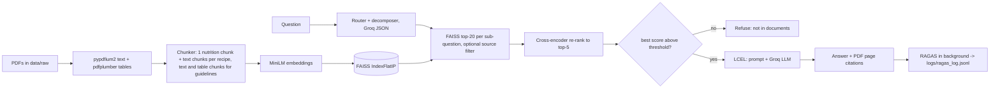

# Recipe & Nutrition Assistant (RAG)

**Domain: Recipe & Nutrition.** Ask questions about recipes (ingredients, method, per-serving nutrition) and general nutrition guidance. Every answer shows the **document and PDF page** it came from; if the documents don't contain the answer, the assistant says so instead of guessing.

**Scope.** Answers come only from two documents: *Healthy Gut, Healthy You* (FSSAI, 2023: probiotic recipes with per-serving energy/protein/carbs/fat) and *Dietary Guidelines for Indians* (ICMR-NIN, 2024). It does not give medical advice, diet plans for health conditions or allergy-safety guarantees, and does not estimate nutrition for dishes the documents don't cover.

- **Live demo:** https://shareappio-vfk68d2wobhqjyoa4cfidh.streamlit.app/
- **Repo:** (https://github.com/hemanth-kandagatla-au9/rag-recipe-nutrition)

## Status: what is real, and how it was checked

Everything below is implemented in code and wired together; **nothing in the running app is mocked**. "Checked by" says how each part was verified. Update the last column after you run `scripts/check_stages.py` on your machine.

| Part | Implemented | Checked by |
|---|---|---|
| PDF parsing + chunking (pypdfium2, pdfplumber tables) | yes | **PASS** (check_stages A, 2026-10-24, macOS 14 / Python 3.12.15): both PDFs, 557 chunks; `tests/test_ingestion.py` passes |
| Embeddings (all-MiniLM-L6-v2) + FAISS index | yes | **PASS** (B1, B2): 557 vectors; "protein in Mishti Doi" returns Mishti Doi chunks at ranks 1-2, identical on repeat. Fixed a macOS segfault (faiss and torch each load libomp; torch now loads first) |
| Cross-encoder re-ranking | yes | **PASS** (C1): in-scope best scores 7.64 / 6.51 / 6.13 vs out-of-scope -11.05 / -10.89 / -10.73. Wider calibration (17 in / 8 out): +2.28 to +8.76 vs -11.05 to -3.35, so `REFUSE_BELOW = -1.0`. Fixed crash/NaN scores caused by misaligned memory-mapped weights (see `rerank.py`) |
| Query routing + decomposition (Groq JSON, rule-based fallback) | yes | **PASS** (C4) with live `gpt-oss-20b` (`via: llm`): "Madra or Kesar Piyush?" routed as `comparison` / `both`. Note: it returned one sub-question rather than splitting into two; C4 only checks for at least one |
| LCEL chain, citations, refusal | yes | **PASS** (C2, C3): "protein in Mishti Doi" answered "22 g per serving" (matches the PDF) citing Healthy Gut PDF pages 26-27; "capital of France" refused (score -11.05). All 5 UI example questions correct, numbers spot-checked against the source |
| RAGAS (faithfulness, answer relevancy, context precision) logged to JSONL | yes | **PASS** (D) and `run_eval.py` on 12 questions: faithfulness 1.000, answer relevancy 0.851, context precision 0.964 (10 scored, 0 errors); refuse/answer behaviour 12/12 |
| FastAPI backend, Streamlit UI | yes | **PASS**: `GET /health` -> `{status: ok, index_ready: true, groq_key_set: true}`; `POST /ask` cited PDF pages 26-27 (10.4 s first call incl. model load, ~1.5-2 s after). Streamlit (in-process mode) answered and refused correctly in the browser. `pytest tests -q`: 12 passed |

The automated tests use small stand-ins for the embedding model, FAISS, the LLM and LangChain so they run anywhere; they test this project's own logic (filtering, merging, refusal, citations, logging), **not** answer quality. Answer quality is what `scripts/check_stages.py` and `scripts/run_eval.py` measure with the real models.

## Architecture



## Tech stack

| Layer | Choice | Why |
|---|---|---|
| PDF text | pypdfium2 | Fast, correct reading order on two-column pages, survives pages that crash pypdf/pdfplumber |
| PDF tables | pdfplumber (only pages with a "Table x.y" caption) | Best table detection; slow, so used sparingly |
| Embeddings | all-MiniLM-L6-v2 (local, CPU) | Small, free, good baseline |
| Vector store | FAISS `IndexFlatIP` on normalised vectors | Exact cosine search, deterministic, saved to disk |
| Re-ranker | cross-encoder/ms-marco-MiniLM-L-6-v2 | Judges question and chunk together; retrieve 20, keep 5 |
| LLM | Groq `openai/gpt-oss-120b` (router: `gpt-oss-20b`) | Free tier; `llama-3.3-70b-versatile` was retired by Groq on 2026-08-16 |
| Orchestration | LangChain Core (LCEL) | `retrieve_stage \| assign(answer)` |
| Evaluation | RAGAS | Reference-free metrics, so no gold answers per query |
| API / UI | FastAPI + Streamlit | Streamlit runs the pipeline in-process when hosted; set `BACKEND_URL` to use the API instead |

Chunking note: the embedding model only reads the first ~256 word pieces (about 1000 characters), so chunks are ~1000 characters (15% overlap) instead of the 500-800 tokens in the project guide; longer chunks would have been silently truncated.

## Setup

Python 3.12 recommended (some ML packages lag behind the newest Python releases).

```bash
python3.12 -m venv .venv && source .venv/bin/activate
pip install -r requirements.txt
cp .env.example .env          # add your GROQ_API_KEY
# put the two PDFs in data/raw/ , then:
python scripts/build_index.py
python scripts/check_stages.py   # real end-to-end check, PASS/FAIL per stage
uvicorn backend.app.main:app --reload      # API   (terminal 1)
streamlit run frontend/app.py              # UI    (terminal 2)
```
Evaluation: `python scripts/run_eval.py` (12 questions, spaced out for Groq's free-tier limits) appends scores to `logs/ragas_log.jsonl`.

## API reference

| Method | Path | Body | Returns |
|---|---|---|---|
| GET | `/health` | | `{status, index_ready, groq_key_set}` (instant; loads no models) |
| GET | `/documents` | | PDFs in `data/raw/` and chunk count |
| POST | `/upload` | multipart `file` (PDF) | Saves the PDF, re-ingests everything, rebuilds the index |
| POST | `/ask` | `{"question": str, "evaluate": true}` | `{answer, refused, citations[{document, pdf_page, section}], route, top_rerank_score, trace}`; RAGAS scoring runs in the background |
| GET | `/eval/log?n=20` | | Last n lines of the RAGAS log |

## Before / after re-ranking

Real output of `python scripts/rerank_example.py` (2026-10-24). Before = cosine similarity from FAISS; after = cross-encoder logit.

Question: *What does the guideline say about diet during pregnancy?* Re-ranking promoted the final #1 chunk from vector rank 14.

| # | Before (vector search) | After (cross-encoder) |
|---|---|---|
| 1 | p33 Page 33 (0.66) | p31 Page 31 (6.12) |
| 2 | p35 Table 2.1. Recommended food groups and r (0.66) | p32 Page 32 (5.26) |
| 3 | p31 Page 31 (0.65) | p8 Page 8 (5.17) |
| 4 | p31 Page 31 (0.62) | p37 Page 37 (5.06) |
| 5 | p34 Page 34 (0.60) | p42 Page 42 (2.73) |

The vector scores are nearly flat (0.60-0.66), so the bi-encoder barely separates the candidates; the cross-encoder spreads them over 2.7-6.1 and pulls up a chunk the vector search had at rank 14.

**Refusal threshold.** `REFUSE_BELOW = -1.0`, calibrated on the best re-rank score per question: 17 in-scope questions scored +2.28 to +8.76 (lowest: "Which has more energy, Madra or Kesar Piyush?"); 8 out-of-scope questions scored -11.05 to -3.35, including near-domain food questions that the PDFs don't cover ("boiling point of water" -3.35, "protein in a Domino's pizza" -3.43, "calories in a Big Mac" -5.99). The earlier default of -4.0 would have let the two near-domain ones through to the LLM.

## RAGAS results

Real run of `python scripts/run_eval.py --pause 20` on all 12 questions in `data/eval/questions.json` (2026-10-24, judge `openai/gpt-oss-120b` on Groq free tier):

| Metric | Mean | Scored |
|---|---|---|
| Faithfulness | 1.000 | 10/10 |
| Answer relevancy | 0.851 | 10/10 |
| Context precision | 0.964 | 10/10 |
| Refuse/answer behaviour correct | 12/12 | (2 out-of-scope questions refused, not scored) |

Lowest scores: answer relevancy 0.50 for "How do I prepare Ragi Ambli?" and context precision 0.64 for "What does the guideline say about diet during pregnancy?" (broad question, several partly relevant guideline pages). Caveats: 10 questions is a small sample, and the judge is the same model family that writes the answers, which can flatter faithfulness.

Two sample lines from `logs/ragas_log.jsonl`:

```json
{"timestamp": "2026-10-24T10:45:47", "question": "How much protein is in one serving of Mishti Doi?", "answer_preview": "The protein content is 22 g per serving【1】.", "refused": false, "route": "simple", "faithfulness": 1.0, "answer_relevancy": 0.7745, "context_precision": 1.0, "status": "ok"}
{"timestamp": "2026-10-24T10:46:39", "question": "How many calories are in Panchamirtham?", "answer_preview": "Panchamirtham contains **429 Kcals per serving**【1】.", "refused": false, "route": "simple", "faithfulness": 1.0, "answer_relevancy": 0.9794, "context_precision": 1.0, "status": "ok"}
```

Each logged line has: timestamp, question, answer preview, faithfulness, answer relevancy, context precision, status. Refused answers are logged but not scored. Scoring failures are logged as `status: error...` and never break an answer.

## Known limitations

- Recipe titles are detected from page layout; a page that deviates from the three layouts seen in the book would be labelled with the previous recipe.
- Guideline chunks are cited by PDF page and the nearest table caption; section headings in that PDF are not machine-readable.
- Page numbers are **PDF page numbers** (what a PDF viewer shows). Printed page numbers differ (Healthy Gut: printed = PDF - 2).
- The refusal threshold (`REFUSE_BELOW`) is calibrated on a handful of questions; borderline questions may be answered or refused wrongly.
- Free Groq limits (tokens per minute) can slow RAGAS scoring; failed scoring is logged, not hidden.
- `gpt-oss` sometimes writes its own inline markers such as `【1】` or `【1†L1-L3】` in the answer text; the structured citations (document + PDF page) below each answer are the reliable ones.
- The router labels multi-part questions (e.g. comparisons) correctly but often keeps them as one sub-question instead of splitting them; retrieval still finds both recipes in practice.

## Sources, credit and permissions

Content is from *Healthy Gut, Healthy You* (FSSAI, 2023) and *Dietary Guidelines for Indians* (ICMR-National Institute of Nutrition, 2024); all rights remain with the publishers. The source PDFs are **not** in this repository. The extracted text chunks in `data/index/` are excerpts of those documents, included so the hosted demo works. Permission status: ICMR-NIN asks for written permission to reproduce its guidelines electronically for a product; **write your status here (requested / granted / not requested, used for coursework only)**.

## Layout

```
backend/app/   ingestion, index, rerank, router, llm, chain, evaluation, main (FastAPI)
frontend/      app.py (Streamlit), client.py (in-process or HTTP)
scripts/       build_index, check_stages, run_eval, rerank_example
tests/         ingestion + pipeline logic tests
data/raw/      PDFs (not committed)    data/index/ chunks + FAISS index    data/eval/ evaluation questions
logs/          ragas_log.jsonl
```
